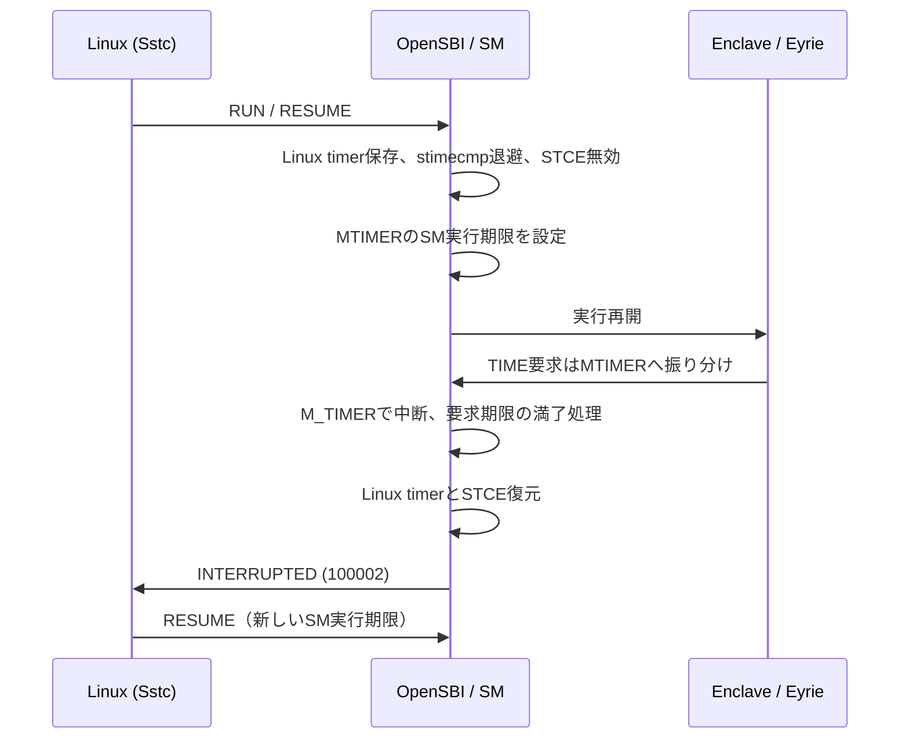

# Linux SstcとKeystone SM M_TIMERの共存

実装コミット：[bff3e8dcb](https://github.com/yutaka-ishikawa/public/commit/bff3e8dcb)。

対象はRV64 K3構成。LinuxではSstcを維持し、enclave/EyrieにはSstcを公開せず、
SMが独立したM_TIMERでプリエンプションする。従来の「Sstcを全体で抑止する」
方式を置き換える。Milk-V Jupiter2は提供された実機情報でSstc対応・出荷Linuxでの
使用を確認済みだが、本変更を実機で実行した結果はまだない。

## 実行モードと状態

| 実行中 | stimecmp / STCE | MTIMER |
| --- | --- | --- |
| Linux、Sstcあり | Linuxの比較値とMENVCFG.STCEを維持。ISA情報からsstcを削除しない。 | 通常OpenSBIの扱い。 |
| enclave/Eyrie | Linuxの比較値を保存しUINT64_MAXへ退避。STCEを0にしてS-modeからの直接アクセスを禁止。 | SMの実行期限とenclaveの要求期限の早い方。 |
| Linuxへの復帰 | 保存した比較値とSTCEを復元。期限切れならハードウェアがSTIPを再生成する。 | enclave用イベントを停止し、ホストの許可状態を復元。 |
| Linux、Sstcなし | stimecmp/STCEにはアクセスしない。 | ホストのSBI設定期限・MTIE・保留STIPを保存／復元する。 |

STIPを単純なsnapshotとしてSstcへ書き戻さない。Sstcでは現在時刻と復元した比較値から
状態が決まる。切替時にはソフトウェア起因のSTIPもclearし、enclaveの割込みを
Linuxのタイマー割込みとして誤って転送しない。



## 実装の分担と既存機能の利用

- `opensbi/platform/generic/spacemit/k3_keystone_timer.c`：共存管理。
  OpenSBIのscratch allocatorでhart別のホスト状態を保持する。
  全体の拡張検出bitを実行ごとに変更しない。
- `opensbi/lib/sbi/sbi_timer.c`：既存のTIME／legacy set_timerの共通入口から、
  enclave実行中だけ共存管理へ振り分ける。Linux側は通常のOpenSBI処理を使う。
- MTIMERの設定・停止は既存の `sbi_timer_device` callback、時刻・周波数はOpenSBI APIを使用。
  物理MMIOアドレスやclockドライバを独自実装しない。割込みACKも `sbi_timer_process()` を使う。
- SMのcontext switch：PMP設定が成功してからhost timerを保存し、vector・context切替後に
  SM timerを設定する。STOP／EXITでは既存のhost context復元に合わせてtimerを復元する。
- `thread_state.enclave_timer_deadline`：enclaveが要求した絶対期限をSM内に保持する。
  OCALL等で停止しても保持し、別hartでRESUMEした場合も同じ期限を参照する。
  host timerは移動元ではなく、実際にRUN／RESUMEを呼んだhartの状態を保存・復元する。

SMの実行期限はRUN／RESUMEごとに10ms（timer_freq/100、最小1tick）。
実際のM-mode処理時間等により中断処理が遅れる場合があり、厳密な実時間上限ではない。

enclaveの要求がそれより早ければ、その期限で中断する。過去の期限は即時中断し、
M_TIMERを処理した時点で満了要求を消費するため、RESUMEが同じ期限で無限に中断しない。
OCALL中に期限が過ぎた場合も、RESUME時に一度中断して消費する。
`set_timer(UINT64_MAX)`はenclaveの要求を取り消すだけで、SMの実行期限を取り消さない。
Eyrieのtimer割込みを直接S-modeへ配送する方式には変更していない。

## 前提・失敗時の扱い

- Sstc対応CPUでも、SM用の利用可能なMTIMERドライバと周波数が必要。
  MTIMERがなければRUN／RESUMEはNOT_RUNNABLEで失敗し、PMPを戻す。
  Sstcだけで動くLinuxのboot自体を、この理由で失敗させる構成にはしない。
- Sstcなしのホストは通常のSBI TIME／legacy timer経路を使用する。
  ホストがOpenSBIを通さずMTIMER MMIOを直接書く構成は、この保存期限追跡の対象外。
- RV32、enclaveへの直接Sstc公開、VS-modeタイマー、CPU hotplug／suspendは今回の対象外。
  既存の固定オンライン方針と、FP/Vector等の未検証範囲は別の問題として残る。
- 実機のMTIMER配線・DT・clock、IPI・PMPの適合性は実機資料に基づいて確認する。
  同じK3ブランチであることだけで動作保証とはしない。

## BuildとQEMUでの確認

通常版、crypto版、RNG各版のfirmware、SDK、専用runtime、検証モジュールを更新する。

```bash
git pull
make build JOBS=4
# 起動中のQEMUを正常終了してから
make install

# Linux Sstc + enclave M_TIMER
python3 verifications/crypto/run-qemu.py --all --sstc on \
    --logs verifications/crypto/results/sstc-on

# Sstcなしの従来経路
python3 verifications/crypto/run-qemu.py --all --sstc off \
    --logs verifications/crypto/results/sstc-off
```

手動起動は `bash scripts/run-k3.sh --sstc on` または `--sstc off`。
指定省略時はCPUモデルの既定値。自動runnerの既定はonで、乱数matrixにも同じ指定を渡す。

起動表示：

```text
[SM/TIMER] host=sstc enclave=mtimer slice-us=10000
# または
[SM/TIMER] host=sbi-mtimer enclave=mtimer slice-us=10000
```

`verifications/sbi-errors`はLinuxのSstc認識と、S-modeでstimecmpを読めることを確認する。
SstcなしではCSRに触れず、そのprofileを表示する。ioctl構造体にtimer情報を追加したため、
古い検証.koと新testを混ぜない。完全な対応kernel出力で再buildしてQEMUを再起動する。

`verifications/sbi-3004`は通常timer区間と、guest timerをキャンセルした区間で、
それぞれ3回以上の非同期STOP／RESUMEを要求する。11回のOCALL、stack/global保持、
LinuxのRUN前／EXIT後のnanosleepによるsleep/wakeupも検査する。
既存の不正request・host禁止・直接yield試験も維持する。

自動runnerの `--all` はsuite成功だけでなく、選択したtimer profileとLinux側の
Sstc確認表示も一致しなければPASSにしない。停止や未到達を成功扱いしない。

## 確認結果と限界

- SM/OpenSBI、通常／専用runtimeと全guest verificationパッケージをbuild。
- Sstc確認を追加したkernel objectをbuild。完全なModule.symversがないため.koリンクは未確認。
- 実QEMUの調査用S-mode runner＋実SM/Eyrie/native eappで、Sstc on/offの両方で
  M_TIMER中断・RESUMEを繰り返し、EXIT／DESTROYまで到達した。
- Sstc onではhost stimecmpの元の絶対値への復元と、期限切れSTIPを確認。
  offでもホスト期限満了のSTIP保留を確認した。
- [観測記録](../verifications/sbi-3004/evidence/sstc-coexistence.md) を参照。

上記の最小runnerはLinuxとdriverを使わない実SBI調査経路。
2026-11-09、共存対応後の現行verification全PASSをユーザーから受領した。
Linuxを含む全suite・11 OCALL試験の成功をユーザー確認済みとして更新する。
今回の申告にコマンド／ログの添付はなく、両profileの実行有無は未明示。
`--sstc off`を含む両profileのLinux全suite成功や、複数enclaveの競合・実機のPASSへは広げない。
上記2 profileのHEAD・manifest・serialログを保存し、対象profileを記録する。

## 追加のLinux実行確認

提供された明示offログではtimer区間と展開で失敗したため、旧全PASS申告とは分けた。
展開readerを修正した新規クラウドLinuxでon/off各3 boot全suiteと乱数7ケースが全PASS。
通常trace=0版のon/off全suiteも確認した。元のtimer失敗は再現せず、artifact照合は未完了。
[調査と実行結果](keystone-verification-off-log-followup.md) を参照。実機は未確認。
